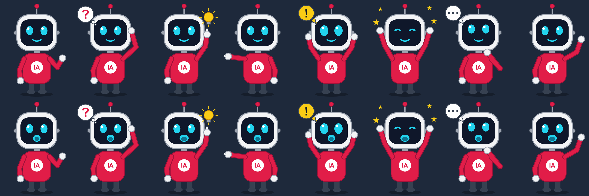

# Estúdio IA YouTube

A Windows desktop app (Electron + TypeScript) that runs a Portuguese-language YouTube channel about technology, AI and the business of innovation — from news research to a published video — with safety and fact-checking rules built in.

> A personal project by AjKaBaL, shared to help anyone who had a similar idea get started more easily.

## What it does

- **Research:** reads RSS feeds and public pages (respecting robots.txt), scores and groups the news, and turns the best stories into topic cards.
- **Multiple sources per video:** for every topic it looks for the same story on other sites and keeps the link to each original article.
- **Fact-checking dossier:** every claim is backed by exact excerpts from at least two independent sources (or one primary source). Unconfirmed claims never reach the script.
- **Scripts with AI:** writes 7–10 minute scripts (or Shorts) from the confirmed claims, then an internal AI reviewer checks them and asks for corrections. Numbers, names and quotes can only come from the dossier.
- **Video production:** narration (local neural voice, Piper), licensed images and videos with provenance and credits, text cards, an original animated presenter, soundtrack, subtitles and FFmpeg rendering up to 4K, followed by automatic quality control.
- **Autopilot:** one button produces everything — topic, dossier, script, review, media, render, quality control and publishing at the scheduled time. Started topics are never abandoned: it keeps researching until the script is ready.
- **Publishing:** YouTube upload with title, chapters, the source articles and image credits in the description, plus synthetic-content disclosure when needed. The YouTube integration is isolated in [`packages/youtube`](packages/youtube/REGRAS.md).
- **Analytics:** metrics, weekly reports and suggestions.

Everything runs locally. The database, credentials vault and media stay on your computer and are never committed (see `.gitignore`). API keys are stored encrypted, never in plain text.

## Getting started (Windows)

1. Install [Node.js](https://nodejs.org/) 22 or newer.
2. Double-click **`Instalar.cmd`** — it installs dependencies and creates the **Estúdio IA YouTube** shortcut on the Desktop and in the Start menu.
3. Open the app from the shortcut (or `Abrir Estudio.cmd`). Inside it, **Configurar tudo com o recomendado** sets up feeds, schedule, local AI and FFmpeg with one click each.

Developer commands: `npm ci` (install), `npm run build` and `npx electron .` (open), `npm run verificar` (types, lint and tests), `npm run empacotar` (installer).

## Use it as a base for your own channel

The project is open source (MIT) so anyone with the same idea can start from a working base instead of from zero. Niche, feeds, schedule, language, voice, presenter character and AI providers can all be changed — see **[docs/ADAPTING.md](docs/ADAPTING.md)**. The same guide lists the ground rules worth keeping when you change it.

## Documentation (Portuguese)

- [User manual](docs/MANUAL.md)
- [Architecture](docs/ARQUITETURA.md)
- [Security](docs/SEGURANCA.md)
- [Progress log](docs/PROGRESSO.md)
- [Scope audit](docs/AUDITORIA.md)

## Responsible use

The app does not invent sources, quotes or metrics, does not copy third-party articles or videos as its own content, keeps license and provenance for every asset, and blocks publishing when there are critical fact-checking or quality issues. No software is 100% secure — review the [security notes](docs/SEGURANCA.md) before use.

## Credits and license

Personal project by **AjKaBaL**, shared to help anyone with a similar idea. Released under the [MIT License](LICENSE).
